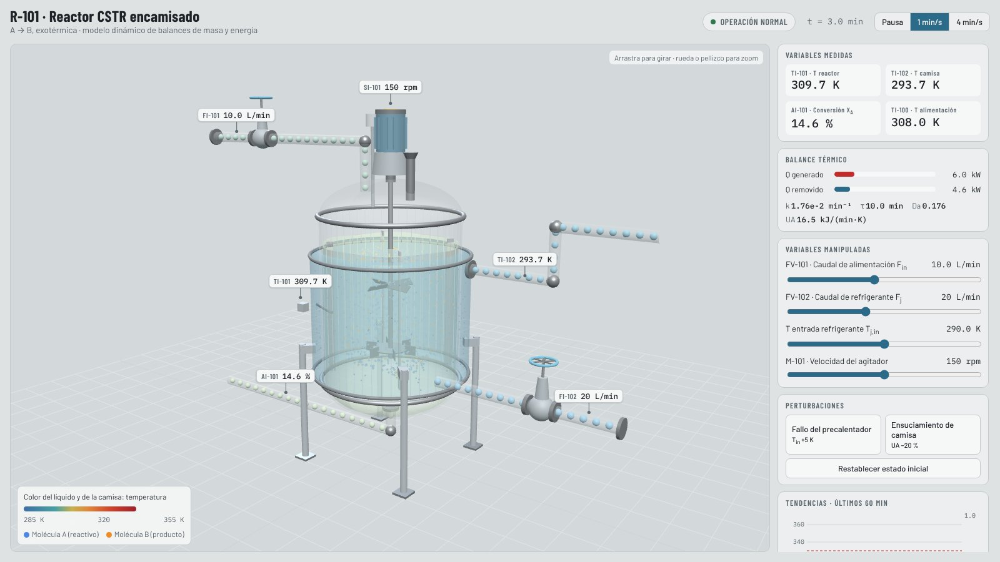
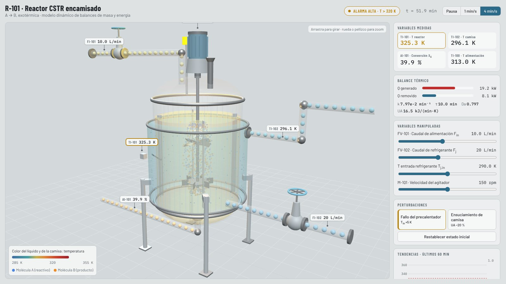

# CSTR HMI Training Simulator

[](https://github.com/juanlaigle-hub/HMI_CSTR/actions/workflows/pruebas.yml)

Operator-training simulator for a jacketed Continuous Stirred Tank Reactor (CSTR) running the exothermic reaction A → B. A Dash HMI in ISA-101 style is linked to an animated 3D view of the reactor, both driven by the same mass and energy balances.

<p> </p>

> More 3D simulators (quadcopter, self-balancing robot, sucker-rod pump, juice evaporator) and two industrial ML projects live in
> **[Simulations3D](https://github.com/juanlaigle-hub/Simulations3D)** ([live site](https://juanlaigle-hub.github.io/Simulations3D/)) and
> **[MachineLearningApplications](https://github.com/juanlaigle-hub/MachineLearningApplications)** ([live site](https://juanlaigle-hub.github.io/MachineLearningApplications/)).

## Features

- Dynamic CSTR model (mass and energy balances, Arrhenius kinetics, RK4) with real-time updates
- Gaussian measurement noise on conversion (X_A), reactor temperature (T) and jacket temperature (T_j); noise is applied to displayed values only, not to the internal state
- Trends show conversion X_A instead of outlet concentration, so the operator sees reaction efficiency directly
- Alarms at T > 320 K (warning) and T > 330 K (critical, runaway)
- Disturbance tools for scenario training: the default is a +5 K preheater failure; the exercise is to raise conversion while keeping T below 320 K
- The initial state is the exact steady state of the base case (T = 310 K, X_A = 0.15, T_in = 308 K)

## 3D view of the reactor

The HMI now includes an animated 3D model of reactor R-101 (`hmi/assets/cstr_3d.html`, built with three.js).
The simulation runs in Python (`hmi/cstr_model.py`) and every tick the state is sent to the 3D view, so the
animation always shows what the model is computing:

| 3D element | What it shows |
|---|---|
| Liquid and jacket colour | Reactor temperature T and jacket temperature T_j (blue → amber → red) |
| Agitator (Rushton turbine + pitched blade) and vortex | Agitator speed; speed also changes the heat-transfer coefficient UA |
| Blue / orange molecules inside the tank | Reactant A turning into product B with the same Arrhenius kinetics; the share of orange follows X_A |
| Spheres moving through the pipes and jacket | Feed flow F_in and coolant flow F_j, coloured by temperature |
| Control valves FV-101 / FV-102 | Hand-wheel and stem move with valve opening |
| Floating instrument tags | TI-101, TI-102, AI-101, FI-101, FI-102, SI-101 with measurement noise |
| Beacon, inner glow and vent vapour | Amber alarm above 320 K, flashing red and vapour above 330 K (runaway) |

Drag to rotate, scroll or pinch to zoom.

## Run from source

```bash
pip install -r requirements.txt
python hmi/app.py
```

The browser opens at `http://127.0.0.1:8050`. three.js is bundled in `hmi/assets/vendor/`, so the 3D view also works without internet.

The 3D page also runs on its own, with its own simulation and control panel: open `hmi/assets/cstr_3d.html` directly in a browser.

To build a standalone Windows executable yourself:

```bash
pyinstaller --onefile --name CSTR_v1.2.0 --add-data "hmi/assets;assets" hmi/app.py
```

### Code structure

- `hmi/cstr_model.py`: mass and energy balances, RK4 integrator, measurement noise, alarm limits.
- `hmi/app.py`: Dash HMI (controls, gauges, trends, disturbances) and the link to the 3D view (`postMessage`).
- `hmi/assets/cstr_3d.html`: 3D scene. With `?mode=hmi` it only shows the 3D view and takes its state from the HMI.
- `hmi/assets/hmi.css`: HMI styling (ISA-101 style: neutral grey, colour reserved for abnormal states).

### Model parameters

C_A,in = 4 mol/L, T_in = 308 K, V = 100 L, V_j = 20 L, ΔH_r = −60 kJ/mol, Ea = 83.14 kJ/mol.
k0 and UA are computed so that the base case (F_in = 10 L/min, F_j = 20 L/min, T_j,in = 290 K, 150 rpm)
is a stable steady state with T = 310 K and X_A = 0.15. With the +5 K preheater failure and no operator action
the reactor runs away to about 339 K; raising F_j to 40 L/min and lowering T_j,in to 285 K brings it back to about 316 K.

## How to operate

- Manipulated variables (MV): coolant flow F_j, feed flow F_in, coolant inlet temperature T_j,in, agitator speed.
- Controlled variables (CV): reactor temperature T and conversion X_A (with noise).
- Trends: temperature, conversion, heat generation and heat removal.

The HMI runs a local web server on port 8050; make sure no other application is using that port.

## Tests

`tests/test_cstr.py` checks the model on every push: exact base steady state, thermal stability at the operating point, runaway to about 339 K after the preheater failure, recovery to about 316 K, and the effect of agitation and fouling on UA.

```bash
python -m unittest discover -s tests -v
```

## Documentation

[`CSTR_Fundamentals.md`](CSTR_Fundamentals.md) covers CSTR operating principles, mass and energy balances, reaction kinetics and recommended scenarios for raising conversion safely.

## Version history

- **v1.2.0:** animated 3D view of reactor R-101 linked to the HMI.
- **v1.1.0:** measurement noise and conversion tracking.

## License

[MIT](LICENSE)

Author: [Juan Laiglecia](https://www.linkedin.com/in/juanlaiglecia) · [Ingeniería VR](https://www.ingenieriavr.com)
